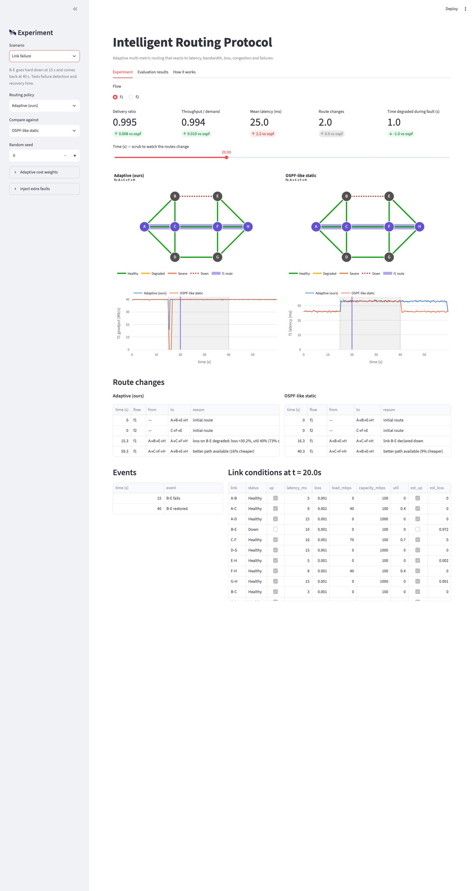
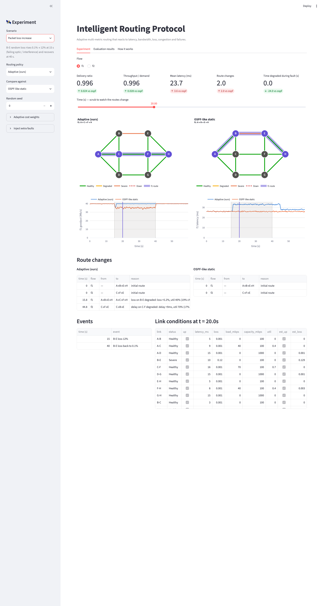
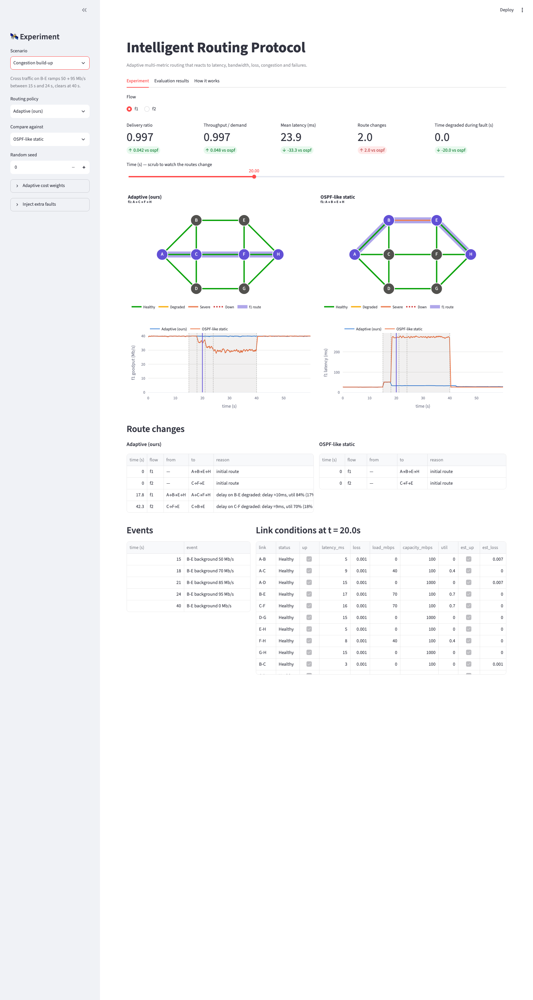
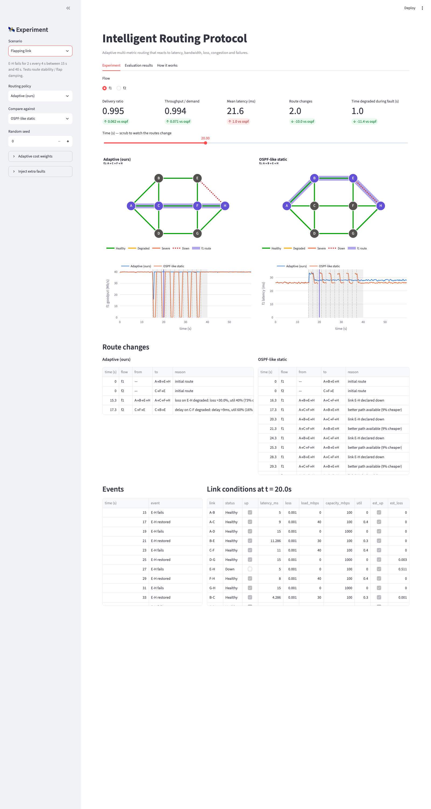
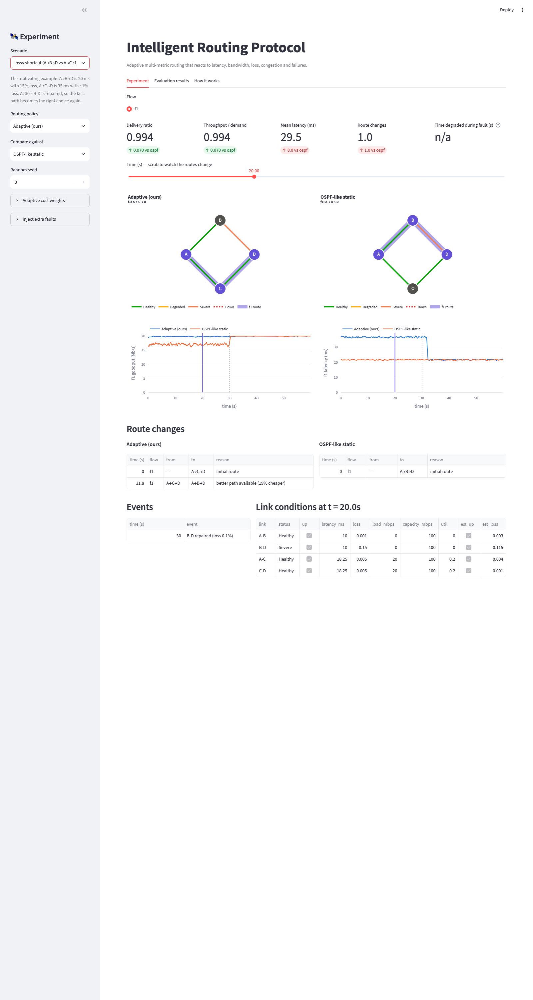
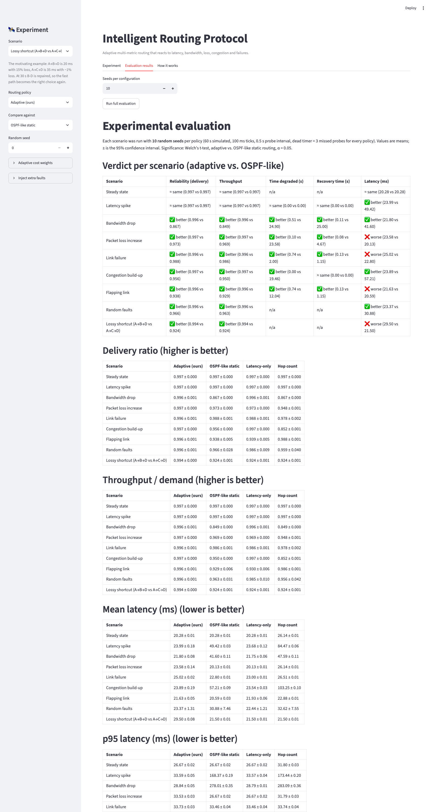
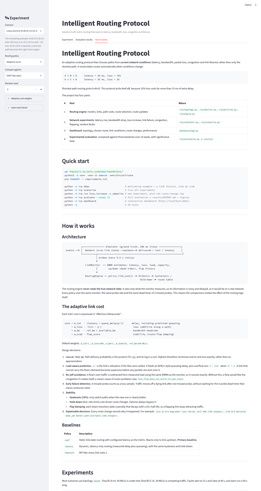

# Intelligent Routing Protocol

**Computer Networks Project · Slot F2 · Team 18**

| Register No. | Name |
|---|---|
| 24BCE2431 | Neha Damani |
| 24BCE2430 | Thipireddy Bhuvana Kruthi |
| 24BCE2514 | Afreen Faizal |

### Submission files

| File | Contents |
|---|---|
| [`submission/F2_Team18_Report.pdf`](submission/F2_Team18_Report.pdf) | Project report (PDF; editable `.docx` alongside) |
| [`submission/F2_Team18_PPT.pptx`](submission/F2_Team18_PPT.pptx) | Project presentation |
| [`submission/F2_Team18_SourceCode.zip`](submission/F2_Team18_SourceCode.zip) | Complete source code (same as `irp/`, `dashboard/`, `tests/` in this repo) |
| [`submission/F2_Team18_Screenshots.zip`](submission/F2_Team18_Screenshots.zip) | Dashboard screenshots (also in [`screenshots/`](screenshots/)) |
| [`results/`](results/) | Evaluation output: `REPORT.md`, CSV data, figures |
| [`testing/`](testing/) | Test-suite output and sample simulation runs |

> **Network simulation:** this project's network simulation is written in Python (`irp/simulator.py`, `irp/scenarios.py`) rather than built in Cisco Packet Tracer. The topologies, link conditions and fault events are defined in code, so no `.pkt` file applies. Every experiment can be reproduced with the commands below.

---

An adaptive routing protocol that chooses paths from **current network conditions** (latency, bandwidth, packet loss, congestion and link failures) rather than only the shortest path. It recalculates routes automatically when conditions change.

```
A → B → D     latency = 20 ms, loss = 15%
A → C → D     latency = 35 ms, loss = 1%
```
Shortest-path routing picks A→B→D. This protocol picks **A→C→D**, because 15% loss costs far more than 15 ms of extra delay.

The project has four parts:

| # | Part | Where |
|---|------|-------|
| 1 | **Routing engine**: routers, links, path costs, route selection, route updates | `irp/topology.py`, `irp/monitor.py`, `irp/policies.py`, `irp/engine.py` |
| 2 | **Network experiments**: latency rise, bandwidth drop, loss increase, link failure, congestion, flapping, random faults | `irp/simulator.py`, `irp/scenarios.py` |
| 3 | **Dashboard**: topology, chosen route, link conditions, route changes, performance | `dashboard/app.py` |
| 4 | **Experimental evaluation**: compared against three baselines over 10 seeds, with significance tests | `irp/evaluation.py` → `results/` |

---

## Software requirements

| Requirement | Version |
|---|---|
| Python | 3.10 or newer (developed and tested on 3.14) |
| OS | macOS, Linux or Windows |
| Python packages | `pandas`, `scipy`, `matplotlib`, `plotly`, `streamlit`, `pytest` (see `requirements.txt`) |
| Browser | Any modern browser, for the dashboard |
| Editor (optional) | Visual Studio Code |

The routing engine itself (`irp/`) uses only the Python standard library. The packages are needed for the evaluation, plots, dashboard and tests.

## Installation

```bash
git clone https://github.com/nehadamani0909/F2_Team18.git
cd F2_Team18
python3 -m venv .venv
source .venv/bin/activate          # Windows: .venv\Scripts\activate
pip install -r requirements.txt
```

## Execution steps

```bash
python -m irp demo                          # 1. motivating example + link failure, OSPF vs adaptive
python -m irp scenarios                     # 2. list the 9 experiments
python -m irp run loss_increase -p adaptive # 3. run one experiment and print the route-change log
python -m irp evaluate --seeds 10           # 4. full evaluation → results/REPORT.md, CSVs, figures
python -m irp dashboard                     # 5. interactive dashboard at http://localhost:8501
pytest -v                                   # 6. run the 29 automated tests
```

## Expected results

- **`demo`**: on the A→B→D vs A→C→D example, OSPF picks the 20 ms path with 15% loss, and the adaptive protocol picks the 35 ms path with about 1% loss. On the link-failure run, the adaptive protocol moves traffic off B-E at about 15.3 s, before OSPF's dead timer fires at about 16.3 s. Sample output: [`testing/demo_output.txt`](testing/demo_output.txt).
- **`evaluate`**: regenerates `results/REPORT.md` and the figures. Adaptive routing has a significantly higher delivery ratio than OSPF-like routing in every fault scenario (for example 0.996 vs 0.867 under a bandwidth drop) and is identical in steady state.
- **`dashboard`**: shows the topology with link health colours, the route each policy chose, live metrics against the baseline, and the evaluation tables. See [`screenshots/`](screenshots/).
- **`pytest`**: `29 passed`. Saved output: [`testing/pytest_results.txt`](testing/pytest_results.txt).

## Testing

| What | Where |
|---|---|
| Unit and integration tests (29): cost model, Dijkstra, failure detection, hysteresis, hold-down, flap damping, determinism, adaptive ≥ static reliability in all 9 scenarios | `tests/test_irp.py` → [`testing/pytest_results.txt`](testing/pytest_results.txt) |
| Sample runs with route-change logs | [`testing/demo_output.txt`](testing/demo_output.txt), [`testing/link_failure_adaptive_run.txt`](testing/link_failure_adaptive_run.txt) |
| Statistical evaluation (10 seeds × 4 policies × 9 scenarios, 95% CIs, Welch t-tests) | [`results/REPORT.md`](results/REPORT.md), `results/*.csv`, `results/fig_*.png` |

## Dashboard screenshots

| | |
|---|---|
|  |  |
|  |  |
|  |  |
|  |  |

---

## Quick start

```bash
python3 -m venv .venv && source .venv/bin/activate
pip install -r requirements.txt

python -m irp demo                          # motivating example + a link failure, side by side
python -m irp scenarios                     # list all experiments
python -m irp run loss_increase -p adaptive # one experiment, with the route-change log
python -m irp evaluate --seeds 10           # full evaluation → results/REPORT.md + figures
python -m irp dashboard                     # interactive dashboard (http://localhost:8501)
pytest -q                                   # 29 tests
```

---

## How it works

### Architecture

```
            ┌──────────────── Simulator (ground truth, 100 ms ticks) ────────────────┐
 events ──▶ │  Network (true link state) ──packets──▶ delivered / lost / latency     │
            └──────────┬──────────────────────────────────────────────────────────────┘
                       │ probes every 0.5 s (noisy)
                       ▼
               LinkMonitor  ── EWMA estimates: latency, loss, load, capacity,
                       │        up/down (dead timer), flap history
                       ▼
               RoutingEngine ── policy.link_cost() ─▶ Dijkstra ─▶ hysteresis /
                                                       hold-down ─▶ route table
```

The routing engine **never reads the true network state**. It sees only what the monitor measures, so its information is noisy and delayed, as it would be on a real network. Every policy uses the same monitor: the same probe rate and the same dead timer of 3 missed probes. This means the comparisons isolate the effect of the routing logic itself.

### The adaptive link cost

Each link's cost is expressed in "effective milliseconds":

```
cost = w_lat  · (latency + queue_delay(ρ'))      delay, including predicted queueing
     + w_loss · −ln(1 − p')                       loss (additive along a path)
     + w_bw   · ref_bw / available_bw             bandwidth headroom
     + w_stab · flap_score                        stability (route-flap damping)
```

Default weights: `w_lat=1`, `w_loss=300`, `w_bw=1`, `w_stab=25`, `ref_bw=100 Mb/s`.

Design decisions:

1. **Loss as −ln(1−p).** Path delivery probability is the product Π(1−pᵢ), and its log is a sum. Dijkstra therefore minimises end-to-end loss exactly, rather than an approximation.
2. **Load-aware prediction.** `ρ'` is the link's utilisation *if this flow were added*. It feeds an M/M/1-style queueing delay, plus overflow loss `1 − 1/ρ'` when `ρ' > 1`. A link that cannot carry the flow's demand becomes expensive before any packets are sent onto it.
3. **No self-avoidance.** A flow's own traffic is subtracted from measured load using the same EWMA as the monitor, so it cancels exactly. Without this, a flow would flee the congestion it creates itself, a classic cause of route oscillation (see `test_flow_does_not_avoid_its_own_load`).
4. **Early failure detection.** A missed probe counts as a loss sample. Traffic moves off a dying link after one missed probe, without waiting for the 3-probe dead timer that classic protocols need.
5. **Stability.**
   - **Hysteresis (15%)**: only switch paths when the new one is clearly better.
   - **Hold-down (3 s)**: rate-limits cost-driven route changes. Failures always bypass it.
   - **Flap damping**: each down transition adds a penalty that decays with a 20 s half-life, so a flapping link stops attracting traffic.
6. **Explainable decisions.** Every route change records why it happened. For example: `loss on B-E degraded: loss ≈30.2%, util 40% (73% cheaper)`, `link B-E declared down`, or `better path available (16% cheaper)`.

### Baselines

| Policy | Description |
|---|---|
| `ospf` | Static link-state routing with configured latency as the metric. Reacts only to link up/down. **Primary baseline.** |
| `latency` | Dynamic, latency-only routing (measured delay plus queueing), with the same hysteresis and hold-down. |
| `hopcount` | RIP-like: every link costs 1. |

---

## Experiments

Most scenarios use topology `mesh8`. Flow **f1** (A→H, 40 Mb/s) is under test; flow **f2** (C→E, 30 Mb/s) is competing traffic. Faults start at 15 s and clear at 40 s, and each run is 60 s long.

```
          B ------ E
        / |        | \
      A - C ------ F - H        A→B→E→H 20 ms (shortest)
        \ |        | /          A→C→F→H 22 ms
          D ------ G            A→D→G→H 45 ms, 1 Gb/s
```

| Scenario | What happens |
|---|---|
| `steady` | No faults (checks that the adaptive policy costs nothing on a healthy network) |
| `latency_spike` | B-E latency rises from 10 ms to 150 ms |
| `bandwidth_drop` | E-H capacity falls from 100 Mb/s to 15 Mb/s |
| `loss_increase` | B-E random loss rises from 0.1% to 12% |
| `link_failure` | B-E goes down, then comes back at 40 s |
| `congestion` | Cross traffic on B-E ramps from 50 Mb/s to 95 Mb/s |
| `flapping` | E-H fails for 2 s every 4 s |
| `chaos` | Seven random faults per seed |
| `lossy_shortcut` | The A→B→D vs A→C→D example; B-D is repaired at 30 s |

Extra faults can be injected from the dashboard sidebar, or in code:

```python
from irp import run_scenario, fail, degrade
r = run_scenario("steady", "adaptive", extra_events=[degrade(10, "C-F", loss=0.2), fail(20, "A-B")])
for c in r.route_changes: print(c.describe())
```

---

## Results (10 seeds, adaptive vs. OSPF-like; full tables in `results/REPORT.md`)

| Scenario | Delivery ratio | Time degraded during fault | Mean latency |
|---|---|---|---|
| Steady state | 0.997 vs 0.997 (≈) | – | 20.3 vs 20.3 ms (≈) |
| Latency spike | ≈ | ≈ | ✅ **24.0 vs 49.4 ms** |
| Bandwidth drop | ✅ **0.996 vs 0.867** | ✅ **0.5 vs 24.9 s** | ✅ 21.8 vs 41.6 ms |
| Packet loss increase | ✅ **0.997 vs 0.973** | ✅ **0.1 vs 23.6 s** | ❌ 23.6 vs 20.1 ms |
| Link failure | ✅ 0.996 vs 0.988 | ✅ **0.7 vs 2.0 s** (recovery 0.13 vs 1.15 s) | ❌ 25.0 vs 22.8 ms |
| Congestion | ✅ **0.997 vs 0.956** | ✅ **0.0 vs 19.5 s** | ✅ 23.9 vs 57.2 ms |
| Flapping link | ✅ **0.996 vs 0.938** | ✅ **0.7 vs 12.0 s** | ❌ 21.6 vs 20.6 ms |
| Random faults | ✅ 0.996 vs 0.966 | – | ✅ 23.4 vs 30.9 ms |
| Lossy shortcut | ✅ **0.994 vs 0.924** | – | ❌ 29.5 vs 21.5 ms |

What the results show:

- **Reliability and throughput.** The adaptive policy is significantly better (p < 0.05) in every fault scenario, and identical in steady state.
- **Recovery.** It moves off a failing link after about 1 probe instead of 3, so recovery is roughly 9× faster. Under flapping, damping keeps it on the stable path; OSPF flaps 12 times and loses about 6% of traffic.
- **Trade-off.** In four scenarios it pays a few milliseconds of latency to avoid loss or instability: it uses a slightly longer clean path, and does not rush back to a link that recently failed. This is intended, and the weights control the trade-off. Raise `w_latency` or lower `w_stability` in the dashboard to see it shift.
- **Where it is not better.** The latency-only dynamic baseline matches it on latency faults, bandwidth drops and congestion, which all show up as delay. It fails on loss faults, link flapping and the lossy-shortcut example, which do not. Those failures are the reason to use multiple metrics.


### Limitations

- This is a flow-level discrete-time simulator, not a packet-level one (no TCP dynamics), and it uses an M/M/1 queueing approximation.
- Routing is per flow and source-routed from global link-state knowledge. Distributed LSA flooding and convergence are not modelled, apart from probe and detection delay.
- Weights are hand-tuned. Learning them, for example with Bayesian optimisation over the scenario suite, is a natural next step.

---

## Project layout

```
irp/
  topology.py     Network, Link, LinkState, queueing/overflow model
  monitor.py      LinkMonitor: probing, EWMA smoothing, dead timer, flap tracking
  policies.py     Adaptive cost function + OSPF / latency-only / hop-count baselines
  engine.py       RoutingEngine: Dijkstra, hysteresis, hold-down, route-change reasons
  simulator.py    Discrete-time simulator, fault events
  scenarios.py    Topologies and the 9 experiments
  metrics.py      Delivery, throughput, latency, recovery time, time degraded
  evaluation.py   Multi-seed runs, CIs, Welch t-tests, figures, REPORT.md
  __main__.py     CLI
dashboard/app.py  Streamlit dashboard
tests/            pytest suite
results/          Generated evaluation output
testing/          Saved test-suite output and sample runs
screenshots/      Dashboard screenshots
submission/       Report (PDF), presentation (PPTX), source-code and screenshot zips
```
