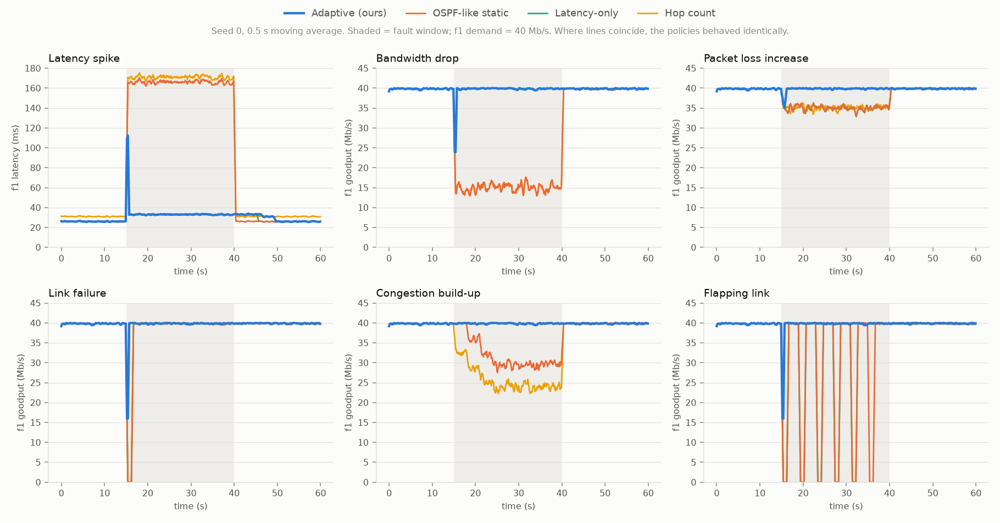
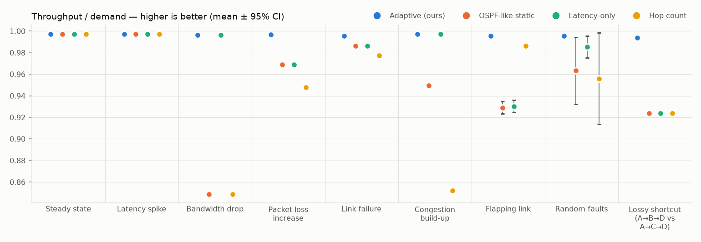
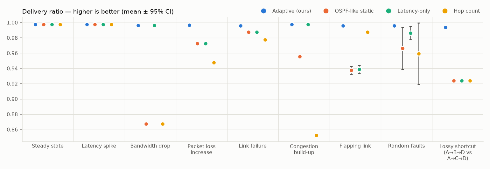
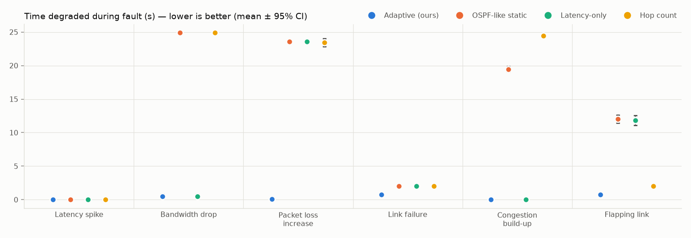
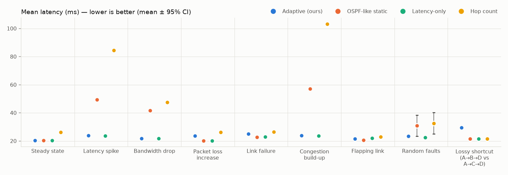

# Experimental evaluation

Each scenario was run with **10 random seeds** per policy (60 s simulated, 100 ms ticks, 0.5 s probe interval, dead timer = 3 missed probes for every policy). Values are means; ± is the 95% confidence interval. Significance: Welch's t-test, adaptive vs. OSPF-like static routing, α = 0.05.

## Verdict per scenario (adaptive vs. OSPF-like)

| Scenario | Reliability (delivery) | Throughput | Time degraded (s) | Recovery time (s) | Latency (ms) |
|---|---|---|---|---|---|
| Steady state | ≈ same (0.997 vs 0.997) | ≈ same (0.997 vs 0.997) | n/a | n/a | ≈ same (20.28 vs 20.28) |
| Latency spike | ≈ same (0.997 vs 0.997) | ≈ same (0.997 vs 0.997) | ≈ same (0.00 vs 0.00) | ≈ same (0.00 vs 0.00) | ✅ better (23.99 vs 49.42) |
| Bandwidth drop | ✅ better (0.996 vs 0.867) | ✅ better (0.996 vs 0.849) | ✅ better (0.51 vs 24.90) | ✅ better (0.11 vs 25.00) | ✅ better (21.80 vs 41.60) |
| Packet loss increase | ✅ better (0.997 vs 0.973) | ✅ better (0.997 vs 0.969) | ✅ better (0.10 vs 23.58) | ✅ better (0.08 vs 4.67) | ❌ worse (23.58 vs 20.13) |
| Link failure | ✅ better (0.996 vs 0.988) | ✅ better (0.996 vs 0.986) | ✅ better (0.74 vs 2.00) | ✅ better (0.13 vs 1.15) | ❌ worse (25.02 vs 22.80) |
| Congestion build-up | ✅ better (0.997 vs 0.956) | ✅ better (0.997 vs 0.950) | ✅ better (0.00 vs 19.46) | ≈ same (0.00 vs 0.00) | ✅ better (23.89 vs 57.21) |
| Flapping link | ✅ better (0.996 vs 0.938) | ✅ better (0.996 vs 0.929) | ✅ better (0.74 vs 12.04) | ✅ better (0.13 vs 1.15) | ❌ worse (21.63 vs 20.59) |
| Random faults | ✅ better (0.996 vs 0.966) | ✅ better (0.996 vs 0.963) | n/a | n/a | ✅ better (23.37 vs 30.88) |
| Lossy shortcut (A→B→D vs A→C→D) | ✅ better (0.994 vs 0.924) | ✅ better (0.994 vs 0.924) | n/a | n/a | ❌ worse (29.50 vs 21.50) |

## Delivery ratio (higher is better)

| Scenario | Adaptive (ours) | OSPF-like static | Latency-only | Hop count |
|---|---|---|---|---|
| Steady state | 0.997 ± 0.000 | 0.997 ± 0.000 | 0.997 ± 0.000 | 0.997 ± 0.000 |
| Latency spike | 0.997 ± 0.000 | 0.997 ± 0.000 | 0.997 ± 0.000 | 0.997 ± 0.000 |
| Bandwidth drop | 0.996 ± 0.001 | 0.867 ± 0.000 | 0.996 ± 0.001 | 0.867 ± 0.000 |
| Packet loss increase | 0.997 ± 0.000 | 0.973 ± 0.000 | 0.973 ± 0.000 | 0.948 ± 0.001 |
| Link failure | 0.996 ± 0.001 | 0.988 ± 0.001 | 0.988 ± 0.001 | 0.978 ± 0.002 |
| Congestion build-up | 0.997 ± 0.000 | 0.956 ± 0.000 | 0.997 ± 0.000 | 0.852 ± 0.001 |
| Flapping link | 0.996 ± 0.001 | 0.938 ± 0.005 | 0.939 ± 0.005 | 0.988 ± 0.001 |
| Random faults | 0.996 ± 0.001 | 0.966 ± 0.028 | 0.986 ± 0.009 | 0.959 ± 0.040 |
| Lossy shortcut (A→B→D vs A→C→D) | 0.994 ± 0.000 | 0.924 ± 0.001 | 0.924 ± 0.001 | 0.924 ± 0.001 |

## Throughput / demand (higher is better)

| Scenario | Adaptive (ours) | OSPF-like static | Latency-only | Hop count |
|---|---|---|---|---|
| Steady state | 0.997 ± 0.000 | 0.997 ± 0.000 | 0.997 ± 0.000 | 0.997 ± 0.000 |
| Latency spike | 0.997 ± 0.000 | 0.997 ± 0.000 | 0.997 ± 0.000 | 0.997 ± 0.000 |
| Bandwidth drop | 0.996 ± 0.001 | 0.849 ± 0.000 | 0.996 ± 0.001 | 0.849 ± 0.000 |
| Packet loss increase | 0.997 ± 0.000 | 0.969 ± 0.000 | 0.969 ± 0.000 | 0.948 ± 0.001 |
| Link failure | 0.996 ± 0.001 | 0.986 ± 0.001 | 0.986 ± 0.001 | 0.978 ± 0.002 |
| Congestion build-up | 0.997 ± 0.000 | 0.950 ± 0.000 | 0.997 ± 0.000 | 0.852 ± 0.001 |
| Flapping link | 0.996 ± 0.001 | 0.929 ± 0.006 | 0.930 ± 0.006 | 0.986 ± 0.001 |
| Random faults | 0.996 ± 0.001 | 0.963 ± 0.031 | 0.985 ± 0.010 | 0.956 ± 0.042 |
| Lossy shortcut (A→B→D vs A→C→D) | 0.994 ± 0.000 | 0.924 ± 0.001 | 0.924 ± 0.001 | 0.924 ± 0.001 |

## Mean latency (ms) (lower is better)

| Scenario | Adaptive (ours) | OSPF-like static | Latency-only | Hop count |
|---|---|---|---|---|
| Steady state | 20.28 ± 0.01 | 20.28 ± 0.01 | 20.28 ± 0.01 | 26.14 ± 0.01 |
| Latency spike | 23.99 ± 0.18 | 49.42 ± 0.03 | 23.68 ± 0.12 | 84.47 ± 0.06 |
| Bandwidth drop | 21.80 ± 0.08 | 41.60 ± 0.11 | 21.75 ± 0.06 | 47.59 ± 0.11 |
| Packet loss increase | 23.58 ± 0.14 | 20.13 ± 0.01 | 20.13 ± 0.01 | 26.14 ± 0.01 |
| Link failure | 25.02 ± 0.02 | 22.80 ± 0.01 | 23.00 ± 0.01 | 26.51 ± 0.01 |
| Congestion build-up | 23.89 ± 0.19 | 57.21 ± 0.09 | 23.54 ± 0.03 | 103.25 ± 0.10 |
| Flapping link | 21.63 ± 0.05 | 20.59 ± 0.03 | 21.93 ± 0.06 | 22.88 ± 0.01 |
| Random faults | 23.37 ± 1.31 | 30.88 ± 7.46 | 22.44 ± 1.21 | 32.62 ± 7.55 |
| Lossy shortcut (A→B→D vs A→C→D) | 29.50 ± 0.08 | 21.50 ± 0.01 | 21.50 ± 0.01 | 21.50 ± 0.01 |

## p95 latency (ms) (lower is better)

| Scenario | Adaptive (ours) | OSPF-like static | Latency-only | Hop count |
|---|---|---|---|---|
| Steady state | 26.67 ± 0.02 | 26.67 ± 0.02 | 26.67 ± 0.02 | 31.80 ± 0.03 |
| Latency spike | 33.59 ± 0.05 | 168.37 ± 0.19 | 33.57 ± 0.04 | 173.44 ± 0.20 |
| Bandwidth drop | 28.84 ± 0.05 | 278.01 ± 0.35 | 28.79 ± 0.01 | 283.09 ± 0.36 |
| Packet loss increase | 33.53 ± 0.03 | 26.67 ± 0.02 | 26.67 ± 0.02 | 31.79 ± 0.03 |
| Link failure | 33.73 ± 0.03 | 33.46 ± 0.04 | 33.46 ± 0.04 | 33.74 ± 0.04 |
| Congestion build-up | 33.76 ± 0.06 | 277.15 ± 0.30 | 33.69 ± 0.06 | 278.00 ± 0.24 |
| Flapping link | 28.82 ± 0.06 | 31.90 ± 0.06 | 32.98 ± 0.12 | 31.16 ± 0.05 |
| Random faults | 39.07 ± 5.63 | 123.46 ± 76.44 | 34.48 ± 5.48 | 106.78 ± 69.21 |
| Lossy shortcut (A→B→D vs A→C→D) | 37.50 ± 0.04 | 22.20 ± 0.04 | 22.20 ± 0.04 | 22.20 ± 0.04 |

## Route changes (lower is better)

| Scenario | Adaptive (ours) | OSPF-like static | Latency-only | Hop count |
|---|---|---|---|---|
| Steady state | 0.0 ± 0.0 | 0.0 ± 0.0 | 0.0 ± 0.0 | 0.0 ± 0.0 |
| Latency spike | 2.6 ± 0.7 | 0.0 ± 0.0 | 2.0 ± 0.0 | 0.0 ± 0.0 |
| Bandwidth drop | 2.0 ± 0.0 | 0.0 ± 0.0 | 2.0 ± 0.0 | 0.0 ± 0.0 |
| Packet loss increase | 2.2 ± 0.5 | 0.0 ± 0.0 | 0.0 ± 0.0 | 0.0 ± 0.0 |
| Link failure | 1.1 ± 0.2 | 2.0 ± 0.0 | 4.0 ± 0.0 | 2.0 ± 0.0 |
| Congestion build-up | 3.6 ± 1.5 | 0.0 ± 0.0 | 4.0 ± 0.0 | 0.0 ± 0.0 |
| Flapping link | 2.0 ± 0.0 | 12.0 ± 0.0 | 19.4 ± 2.0 | 1.0 ± 0.0 |
| Random faults | 3.5 ± 1.3 | 0.6 ± 0.7 | 4.5 ± 2.6 | 0.2 ± 0.3 |
| Lossy shortcut (A→B→D vs A→C→D) | 1.0 ± 0.0 | 0.0 ± 0.0 | 0.0 ± 0.0 | 0.0 ± 0.0 |

## Throughput during fault (f1) (higher is better)

| Scenario | Adaptive (ours) | OSPF-like static | Latency-only | Hop count |
|---|---|---|---|---|
| Latency spike | 0.997 ± 0.000 | 0.997 ± 0.000 | 0.997 ± 0.000 | 0.997 ± 0.000 |
| Bandwidth drop | 0.992 ± 0.003 | 0.372 ± 0.002 | 0.992 ± 0.003 | 0.372 ± 0.002 |
| Packet loss increase | 0.994 ± 0.001 | 0.878 ± 0.002 | 0.878 ± 0.002 | 0.878 ± 0.002 |
| Link failure | 0.989 ± 0.004 | 0.949 ± 0.004 | 0.949 ± 0.004 | 0.949 ± 0.004 |
| Congestion build-up | 0.997 ± 0.000 | 0.796 ± 0.001 | 0.997 ± 0.000 | 0.648 ± 0.003 |
| Flapping link | 0.989 ± 0.004 | 0.710 ± 0.024 | 0.715 ± 0.024 | 0.949 ± 0.004 |

## Recovery time (s) (lower is better)

| Scenario | Adaptive (ours) | OSPF-like static | Latency-only | Hop count |
|---|---|---|---|---|
| Latency spike | 0.00 ± 0.00 | 0.00 ± 0.00 | 0.00 ± 0.00 | 0.00 ± 0.00 |
| Bandwidth drop | 0.11 ± 0.09 | 25.00 ± 0.00 | 0.11 ± 0.09 | 25.00 ± 0.00 |
| Packet loss increase | 0.08 ± 0.14 | 4.67 ± 3.26 | 4.67 ± 3.26 | 10.70 ± 7.63 |
| Link failure | 0.13 ± 0.10 | 1.15 ± 0.11 | 1.15 ± 0.11 | 1.15 ± 0.12 |
| Congestion build-up | 0.00 ± 0.00 | 0.00 ± 0.00 | 0.00 ± 0.00 | 25.00 ± 0.00 |
| Flapping link | 0.13 ± 0.10 | 1.15 ± 0.11 | 1.15 ± 0.11 | 1.15 ± 0.11 |

## Time degraded during fault (s) (lower is better)

| Scenario | Adaptive (ours) | OSPF-like static | Latency-only | Hop count |
|---|---|---|---|---|
| Latency spike | 0.00 ± 0.00 | 0.00 ± 0.00 | 0.00 ± 0.00 | 0.00 ± 0.00 |
| Bandwidth drop | 0.51 ± 0.39 | 24.90 ± 0.00 | 0.51 ± 0.39 | 24.90 ± 0.00 |
| Packet loss increase | 0.10 ± 0.17 | 23.58 ± 0.34 | 23.58 ± 0.34 | 23.43 ± 0.61 |
| Link failure | 0.74 ± 0.33 | 2.00 ± 0.08 | 2.00 ± 0.08 | 2.00 ± 0.10 |
| Congestion build-up | 0.00 ± 0.00 | 19.46 ± 0.42 | 0.00 ± 0.00 | 24.44 ± 0.06 |
| Flapping link | 0.74 ± 0.33 | 12.04 ± 0.61 | 11.83 ± 0.72 | 2.00 ± 0.08 |

## Figures

## Metric definitions

- **Delivery ratio** – delivered / sent packets, all flows.
- **Throughput / demand** – delivered goodput divided by offered load, all flows.
- **Throughput during fault** – the same, for flow f1 only, inside the fault window.
- **Recovery time** – seconds from the fault until f1's goodput is back to ≥ 90% of its pre-fault level for 1 s. If it never recovers inside the fault window, the full window length is counted.
- **Time degraded** – seconds inside the fault window during which f1's goodput (1 s moving average) was below 90% of its pre-fault level. Captures gradual faults and repeated outages, where a single recovery time is misleading.
- **Route changes** – route switches after the initial route installation, all flows.
